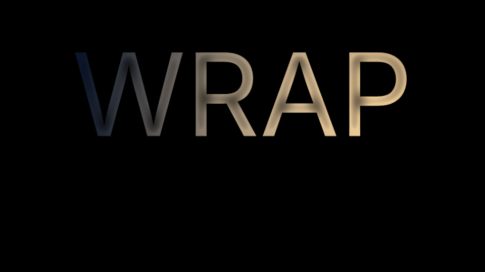

# mos_灯光混合 / mos_lightmix v1.5.0

EffectCraft 版的 Light Wrap 效果（灵感来自 Digital Anarchy 的同类效果，代码与素材均为独立实现）：
把背景层的光「绕」到抠像主体的边缘上，让合成看起来不是贴上去的。


| 渲染 = 合成 | 渲染 = 仅光晕 |
| --- | --- |
|  |  |

---

## 一、它做什么

真实拍摄里，背景的强光会经镜头衍射绕到主体边缘，在抠像边缘内侧留下一圈背景色的溢光。
mos_灯光混合 复刻这个现象：

1. 取前景层 alpha，做出向内的**边带**：`band = clamp(2·A·(1 − blur(A, 尺寸/2)), 0, 1)`，
   在边缘处最强，向层内衰减；
2. 取背景（图层，或背景色），按「尺寸」自动模糊，「背景模糊」再额外叠加；
3. 用「混合模式」把背景光混进边带，「亮度」控制强度；
4. 「遮罩」区把光晕限制在画面某个区域（渐变，或用另一图层的亮度/alpha 当遮罩）。

## 二、安装

插件以 **external effect helper**（独立进程）的形式提供，EffectCraft 启动时会扫描 `helpers` 目录。

```
把 dist\effectcraft-helper-mos-lightmix.exe
  复制到 C:\Users\<你>\AppData\Roaming\EffectCraft\helpers\
```

EffectCraft **默认不会在启动时启动外部 helper**，所以还要装一个开机自加载脚本（`build.ps1` 会自动做这一步）：

```
把 tools\mos-load-helpers.jsx
  复制到 C:\Users\<你>\AppData\Roaming\EffectCraft\Scripts\Startup\
```

它会在每次启动时调用一次 `effect.helpers.scan`。装好后重启 EffectCraft，效果列表的 **MOS** 分类
（和 mos_shadow / mos_shake 同一个组）里就会出现 **mos_灯光混合**。

> 全靠这一个脚本：helper 目录里放好 exe、Startup 里放好 jsx，之后每次启动都会自动加载。
> 脚本需要 **设置 ▸ 脚本与表达式 ▸ 允许脚本写入文件和访问网络** 处于打开状态（默认关，本机已开）。
>
> 已经开着的窗口不会自己发现新装的 helper：在菜单里点一次 **效果 ▸ 扫描效果辅助程序...** 即可立刻出现。
> 找不到效果、或者加了没反应，先看这一条。

> 已在 EffectCraft 0.24.1 上验证；不需要 AE、不需要 Python，只依赖 EffectCraft 自带的 helper 协议。

### 语言

helper 是同一份 exe，启动时按下面的顺序决定分组/效果名（names）和参数名/选项（params）的语言：

1. 环境变量 `MOS_NAMES_LANG` / `MOS_PARAMS_LANG`（`zh` 或 `en`；`MOS_LANG` 同时设置两者，供调试用）；
2. `%APPDATA%\EffectCraft\mos-suite.json` 的 `namesResolved` / `paramsResolved`（套件安装器写入的实际生效语言）；
3. 同一文件的 `namesLanguage` / `paramsLanguage`（`system` 按英文处理）；
4. 旧版的 `effectsLanguage`（同时设置两者）；
5. 都没有时英文。

## 三、用法

1. 选中抠好的前景层（带 alpha 的那层）→ 加 **mos_灯光混合**；
2. 「背景」选合成里真正的背景层（最真实）；留空则用「背景色」纯色；
3. 调「尺寸」：从 10–40 起步，看着边缘那圈光长大；「亮度」100 为原亮度；
4. 「混合模式」默认 **滤色**（最容易看出效果），想更自然用 **柔光/叠加**，要更强的边缘高光用 **相加**；
5. 背景光有变化时给「亮度」打关键帧。

演示工程：`mos_灯光混合 演示.ecproj`，两个合成——「灯光混合 · 文字」和「灯光混合 · 色块」。

## 四、控件

| 控件 | 类型 | 默认 | 作用 |
| --- | --- | --- | --- |
| 渲染 | 下拉 | 合成 | 合成 = 光晕叠在前景上；仅光晕 = 只输出光晕（黑底或背景色），方便 Screen 合成 |
| 背景 | 图层 | 空 | 参考背景层；空 = 用「背景色」 |
| 背景色 | 颜色 | 暖白 | 没有背景层时的底色，也是「仅光晕」模式的底色 |
| 背景模糊 | 0–200 | 0 | 在「尺寸」自动模糊之外，再额外模糊背景 |
| 缩放背景 | 勾选 | 开 | 保留原版控件；EffectCraft 已把背景重采样进本层网格，故为占位 |
| 尺寸 | 0–500 px | 24 | 光晕向内包裹的宽度；越大背景也越模糊 |
| 混合模式 | 下拉 | 滤色 | 柔光 / 叠加 / 相加 / 正片叠底 / 滤色 / 颜色 |
| 亮度 | 0–200 % | 100 | 光晕亮度 |
| 显示遮罩 | 勾选 | 关 | 预览遮罩（灰度图） |
| 遮罩样式 | 下拉 | 渐变 | 渐变；图层（用另一层当遮罩） |
| 中心点 | 点 | 画面中心 | 渐变白端位置 |
| 宽度 | 0–400 % | 120 | 渐变宽度，按图层宽度百分比 |
| 角度 | 角度 | 0 | 渐变方向（沿此方向变暗） |
| 遮罩输入 | 图层 | 空 | 遮罩样式 = 图层时要用的那一层 |
| 遮罩通道 | 下拉 | 亮度 | 亮度 / Alpha |
| 反转遮罩 | 勾选 | 关 | 遮罩取反 |
| 使用 GPU | 勾选 | 关 | 保留原版控件；本实现为 CPU，占位 |

调参小抄：边缘发白过头就降「亮度」；想只脏边缘不想亮整块就收小「尺寸」；
要去绿/蓝溢色用「相加」；只想给画面一侧加光用「遮罩样式 = 渐变」。

## 六、加了没反应？按这个排查

1. **效果根本没加载**：效果列表里搜不到「mos_灯光混合」→ 检查
   `%APPDATA%\EffectCraft\Scripts\Startup\mos-load-helpers.jsx` 在不在，
   或者直接在菜单点 **效果 ▸ 扫描效果辅助程序...**（一次即可，不用重启）。
   （`effect.helpers.list` 里应该能看到 `mos_灯光混合 ... running:true`。）
   备用手段：双击 `启动 EffectCraft（自动加载灯光混合）.bat` 启动，它用环境变量 `EFFECTCRAFT_HELPERS=1` 强制加载。
2. **前景太亮**：柔光/叠加/相加 在**纯白**像素上没有可加的亮度，边缘自然不会变（滤色仍有轻微作用）。
   白色字幕、纯白产品图就会「没反应」——换 **正片叠底**（会压暗）或 **颜色**（染色）立刻能看出来，
   或者把「亮度」拉到 150+ 再降回来。
3. **没选背景、背景色又太暗**：背景色是光的来源，黑色 = 没有光。选背景层，或把背景色调亮。
4. **尺寸太小**：24px 以下在 1080p 大主体上只是一条细线，先把「尺寸」拉到 60–100 看有没有，
   再回调。
5. **遮罩把它挡住了**：「显示遮罩」勾上看看白区在哪；「宽度」为 0 或「反转遮罩」勾上都会让光晕消失。

## 七、与原版的差异（如实说明）

- **遮罩样式没有 Path**：AE 蒙版路径无法传给 helper，「渐变」和「图层」两种完整可用。
- **缩放背景 / 使用 GPU** 是占位开关：EffectCraft 已自动把背景重采样进本层网格；本插件是纯 CPU 实现（3 次 box blur 近似高斯，速度够）。
- 原版的「尺寸变大时背景自动更模糊」保留：基础模糊半径 = 尺寸/2，「背景模糊」叠加其上。
- 「宽度」与「中心点」的语义与原版一致（宽度按图层宽度百分比）。

## 八、目录 / 构建

```
D:\mossls\mos\vfx\mos_灯光混合\
├─ helper/            Rust 源码：main.rs 协议层、lwf.rs 效果、blur.rs 高斯近似
├─ dist/              编译好的 helper exe
├─ docs/              演示截图
├─ tools/             mos-load-helpers.jsx（开机自加载脚本，build.ps1 会装到 Scripts\Startup）
├─ build.ps1          一键构建 + 安装
├─ 启动 EffectCraft（自动加载灯光混合）.bat   备用启动器
└─ mos_灯光混合 演示.ecproj
```

重新构建：`.\build.ps1`（本机 Rust 环境 `D:\ruanjian\rust-env`，离线 crate 缓存；
helper 文件名必须以 `effectcraft-helper-` 开头才会被扫描到）。

## 九、协议要点（维护备忘）

- 启动读 `hello`（含帧交换文件路径）；`describe` 返回 manifest；`padding` 返回建议外扩像素；
  `render` 的 `frame` 指向交换文件里的预乘 RGBA f32 缓冲（原地修改）；
- 渲染中要别的图层像素时发 `{"op":"layer_input","param":"<参数 id>","time":t}`，
  宿主回 `image`（与 frame 同尺寸/origin/scale）；等待期间可能穿插嵌套 `render`，需递归处理；
- 带 padding 时 `frame.origin` 是图层左上角在缓冲里的位置，`layer_size` 是图层自身像素尺寸，
  图层矩形之外是脚下内容的直通区，不能覆盖。

## 十、已知限制：背景层的变换读不到

外部 helper 的 `layer_input` 只返回背景图层**自身**的画面（效果和遮罩已应用），不含图层的位置 / 缩放 / 旋转；宿主会把它按尺寸居中、缩放进效果层网格。所以：

- 动背景层的 `位置/缩放/旋转`，光晕**不跟着动**；
- 前景层（挂效果的那层）不受影响，它的变换是在效果之后应用的，光晕会跟着主体走。

需要背景跟着动时：把背景做成**与合成等大的预合成**，在预合成**里面**做动画 —— 内部动画会按当前时间被读到，位置也自然对齐。

## 十一、拖动滑杆把 EffectCraft 拖死（v1.3.2 修）

现象：拖「尺寸 / 亮度 / 混合模式」几分钟后，**预览画面彻底不动**（隐藏图层也不消失、时间码还在走），
`%APPDATA%\EffectCraft\Logs\effectcraft.log` 里是十几条
`the effect helper was busy for more than 600 s`，窗口没有崩、关不掉渲染，只能关掉重开。

原因在**协议层**（不是参数数组、不是模糊算法）：

1. 宿主有 16 个渲染线程并发求值，helper 只有一个进程、一条 stdin；
2. helper 在某个 `render` 内部发 `layer_input` 等宿主回图（`ask_layer`，`main.rs` 里那个循环）
   —— 这一等**没有超时**；同时宿主那边 `host.layer_input()` 是在渲染线程上同步跑的，也没有超时；
3. 于是 helper 卡在读 stdin 上，这期间到达的 `padding` 请求没人处理（旧版还会被 `ignored while waiting` 静默丢掉）；
4. 其它 15 个渲染线程拿不到 helper 的使用权，只能耗满宿主的 600 s「turn 超时」；
5. 宿主只 `WARN` 不放弃，整条渲染管线就永久堵死 —— 连不经过本插件的合成也不出帧。

v1.3.2 的改法（`helper/src/main.rs`、`helper/src/lwf.rs`）：

- `ask_layer` 改成**带超时**的等待：超过 `MOS_LIGHTWRAP_LAYER_TIMEOUT`（默认 20 s）就放弃这次求值，
  这次 `render` 回 `error`（效果上会显示「图层 `background` 等了 20 s 没有回图像」），
  **helper 进程继续活着**，下一次渲染照常 —— 不会再整机卡死；
- 等待图层的循环里顺手应答 `padding` / `ping` / 嵌套 `render`，不再吞掉请求；
- 图层图像**缓存** `MOS_LIGHTWRAP_LAYER_CACHE_SECS`（默认 3 s，按「参数 + 时间」命中）：
  拖滑杆时同一时间点只会向宿主求一次背景图，滑杆明显跟手；
- stdin 改成独立读线程 + 通道（`spawn_reader`），读输入不再和渲染抢同一个锁；
- 两个新环境变量都可用：`MOS_LIGHTWRAP_LAYER_TIMEOUT`（秒，1 起，0 无效）、
  `MOS_LIGHTWRAP_LAYER_CACHE_SECS`（秒，0 = 关缓存）。

顺带修的两个问题：

- `padding` 现在按 `scale` 换算（旧版忽略缩放，预览缩小 50% 时仍按 100% 外扩 → 每帧都多算一大圈像素）；
- 模糊半径乘 `scale`（旧版在缩小预览下模糊过重、还更慢）。

**注意**：这是 helper 侧的兜底。宿主侧 `host.layer_input()` 回调没有超时（`crates/helper-host/src/client.rs`
的 `converse`）才是把人拖死的另一半，已按这个结论向上游反馈。

自测（不开 EffectCraft，直接跟 helper 对话）：

```
python tools/protocol_check.py           # 11 项：hello / describe / padding 按缩放 /
                                         # 无背景层渲染 / 等不到图超时回 error 且进程不死 /
                                         # 等图期间 padding 有应答 / 第二次渲染命中缓存
```

---

## 许可 / License

AGPL-3.0-or-later（GNU Affero 通用公共许可证第 3 版或更高版本），见仓库根目录的 `LICENSE`。
